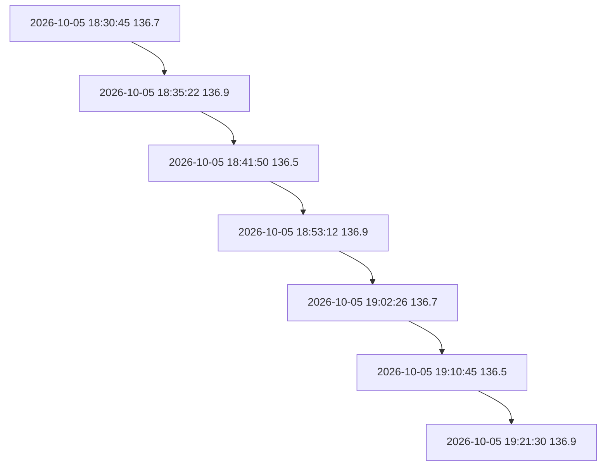

# Fase 2: Meça o funcionamento real

Executem a árvore da Fase 1 com os arquivos de carga de N = 1.000, 5.000 e 20.000 comandos `REG`, em duas versões: quase em ordem, que é como as chegadas são informadas no dia a dia, e embaralhadas, como se tivessem sido recuperadas de um backup fora de ordem. Executem cada arquivo cinco vezes, registrem em uma tabela a mediana dos tempos e a altura da árvore ao final da execução e respondam por escrito:

`Computador 1`
| Arquivo de carga | N | Mediana do tempo (ms) | Altura final |
|---|---|---|---|
| carga_quase_ordem_1000.txt | 1000 | 45.290 | 889 |
| carga_quase_ordem_5000.txt | 5000 | 830.732 | 4458 |
| carga_quase_ordem_20000.txt | 20000 | 12667.773 | 17750 |
| carga_embaralhada_1000.txt | 1000 | 23.749 | 22 |
| carga_embaralhada_5000.txt | 5000 | 1239.998 | 30 |
| carga_embaralhada_20000.txt | 20000 | 71473.802 | 32 |

`Computador 2`
| Arquivo de carga | N | Mediana do tempo (ms) | Altura final |
|---|---|---|---|
| carga_quase_ordem_1000.txt | 1000 | 134.706 | 889 |
| carga_quase_ordem_5000.txt | 5000 | 2397.026 | 4458 |
| carga_quase_ordem_20000.txt | 20000 | 21618.355 | 17750 |
| carga_embaralhada_1000.txt | 1000 | 38.875 | 22 |
| carga_embaralhada_5000.txt | 5000 | 2033.653 | 30 |
| carga_embaralhada_20000.txt | 20000 | 128932.972 | 32 |

`Computador 3` 
| Arquivo de carga | N | Mediana do tempo (ms) | Altura final |
|---|---|---|---|
| carga_quase_ordem_1000.txt | 1000 | 110.003 | 889 |
| carga_quase_ordem_5000.txt | 5000 | 2102.547 | 4458 |
| carga_quase_ordem_20000.txt | 20000 | 41944.592 | 17750 |
| carga_embaralhada_1000.txt | 1000 | 58.223 | 22 |
| carga_embaralhada_5000.txt | 5000 | 5041.255 | 30 |
| carga_embaralhada_20000.txt | 20000 | 261287.141 | 32 |

`Média dos computadores`
| Arquivo de carga | N | Mediana do tempo (ms) | Altura final |
|---|---|---|---|
| carga_quase_ordem_1000.txt | 1000 | 96.666 | 889 |
| carga_quase_ordem_5000.txt | 5000 | 1776.768 | 4458 |
| carga_quase_ordem_20000.txt | 20000 | 25410.24 | 17750 |
| carga_embaralhada_1000.txt | 1000 | 40.282 | 22 |
| carga_embaralhada_5000.txt | 5000 | 2771.635 | 30 |
| carga_embaralhada_20000.txt | 20000 | 153897.971 | 32 |

---

**(a)** qual é a relação entre a altura da árvore e os tempos medidos? Usem a razão entre os tempos de N = 1.000 e de N = 20.000 nas duas versões.  

`Relação entre altura e tempo`
| Carga | Tempo N = 1000 | Tempo N = 20000 | Razão 
|---|---|---|---|
| Quase em ordem | 96.666 ms | 25410.24 ms | 262.9 vezes |
| Emabaralhada | 40.282 ms | 153897.971 ms | 3820.5 vezes |

Para a carga quase em ordem, a altura da árvore aumentou de 889 para 17.750 quando o número de registros passou de 1.000 para 20.000. Então, fica evidente um grande desbalanceamento da árvore, o que resulta em um aumento no número de nós que precisam ser percorridos durante as operações.  

Já na versão embaralhada, a altura aumentou apenas de 22 para 32, mantendo a árvore mais equilibrada. Porém, seu tempo de execução cresceu mais que o da versão quase em ordem.

Portanto, é observado que a altura da árvore influencia o custo das operações, pois árvores mais altas exigem mais comparações durante as buscas e inserções. Entretanto, de acordo com os resultados obtidos, o tempo total de execução não depende apenas da altura, já que a versão embaralhada apresentou tempos maiores, mesmo com alturas menores. Assim, outros fatores da implementação podem, também, estar influenciando as medições.

---

**(b)** desenhem, à mão ou no computador, a árvore que se forma ao inserir sete chegadas em ordem de data e horário. Qual é o formato dela e qual é a complexidade da busca nesse caso?

`Árvore com sete chegadas em ordem`

**Formato:** Árvore binária degenerada, pois cada novo registro é maior que o anterior, sendo sempre inserido a direita do último nó.  
**Complexidade:** O(n), no pior caso, se for necessário percorrer todos os nós.
