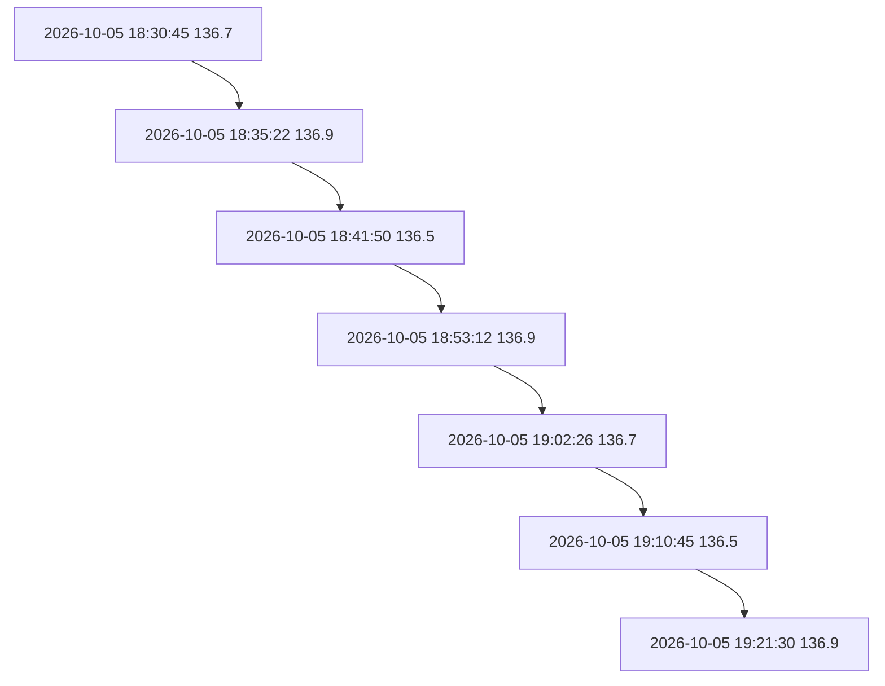

# Fase 2: Meça o funcionamento real

Executem a árvore da Fase 1 com os arquivos de carga de N = 1.000, 5.000 e 20.000 comandos `REG`, em duas versões: quase em ordem, que é como as chegadas são informadas no dia a dia, e embaralhadas, como se tivessem sido recuperadas de um backup fora de ordem. Executem cada arquivo cinco vezes, registrem em uma tabela a mediana dos tempos e a altura da árvore ao final da execução e respondam por escrito:

`Resultados`
| Arquivo de carga | N | Mediana do tempo (ms) | Altura final |
|---|---|---|---|
| carga_quase_ordem_1000.txt | 1000 | 66.116 | 889 |
| carga_quase_ordem_5000.txt | 5000 | 1547.242 | 4458 |
| carga_quase_ordem_20000.txt | 20000 | 26012.924 | 17750 |
| carga_embaralhada_1000.txt | 1000 | 5.012 | 22 |
| carga_embaralhada_5000.txt | 5000 | 21.254 | 30 |
| carga_embaralhada_20000.txt | 20000 | 100.888 | 32 |

---

**(a)** qual é a relação entre a altura da árvore e os tempos medidos? Usem a razão entre os tempos de N = 1.000 e de N = 20.000 nas duas versões.  

`Relação entre altura e tempo`

 |  | N = 1.000 | N = 20.000 | Razão entre os tempos | Aumento do tempo |
 |---|---|---|---|---|
 | Quase Ordenada | 889 | 17.750 | 26.012,924 ÷ 66,116 | 393,44 vezes
 | Embaralhada | 22 | 32 | 00,888 ÷ 5,012 | 20,13 vezes |

Quanto maior a altura da árvore, maior tende a ser o tempo de execução. Na carga quase ordenada, a árvore fica degenerada, com altura próxima de N, resultando em crescimento do tempo próximo de O(N²). Já na carga embaralhada, a árvore mantém altura próxima de O(log N), apresentando crescimento do tempo compatível com O(N log N).

Assim, a carga embaralhada apresenta desempenho significativamente superior, pois sua menor altura reduz o custo das operações de inserção.

---

**(b)** desenhem, à mão ou no computador, a árvore que se forma ao inserir sete chegadas em ordem de data e horário. Qual é o formato dela e qual é a complexidade da busca nesse caso?

`Árvore com sete chegadas em ordem`

**Formato:** Árvore binária degenerada, pois cada novo registro é maior que o anterior, sendo sempre inserido a direita do último nó.  
**Complexidade:** O(n), no pior caso, se for necessário percorrer todos os nós.
